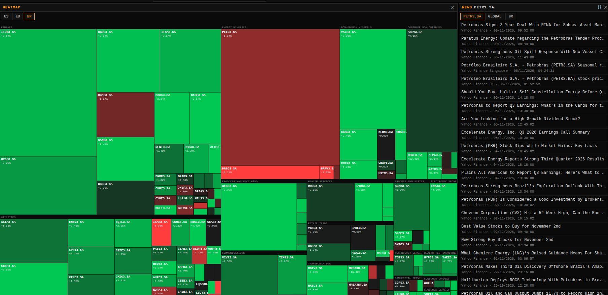
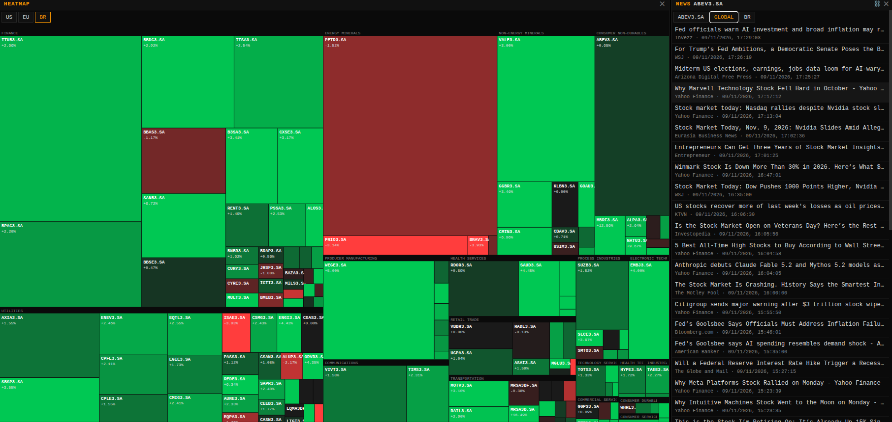

# Teste prático — Desenvolvedor(a) Full Stack

## Dois widgets de mercado: Heatmap da B3 e Notícias por ativo

> **Documento do processo seletivo**
>
> Backend: PHP 8.3+ — Laravel recomendado
>
> Mercado-alvo: **B3 (Brasil)**
>
> Prazo: **24 horas corridas** a partir do recebimento deste documento.

---

## Referência visual

As imagens abaixo são a **implementação de referência**. Reproduza o comportamento e o contrato de dados, não o estilo visual. Fonte, cor exata e espaçamento são livres.



*Figura 1 — Heatmap da B3 e notícias no modo por ativo. O título do widget acompanha o símbolo ativo (`NEWS PETR3.SA`), definido ao clicar em Petrobras no heatmap.*



*Figura 2 — Mesmo heatmap, notícias em modo de mercado. O símbolo ativo agora é `ABEV3.SA`, mas o modo de mercado ignora o símbolo. Veículos diferentes comprovam a mescla de duas fontes independentes.*

### O que as imagens comprovam

| Elemento visível | Requisito |
|---|---|
| Retângulos agrupados sob rótulos de setor (`FINANCE`, `ENERGY MINERALS`, …) | Agrupamento por setor — 2.2 |
| `PETR3.SA` ocupando a maior área de Energy Minerals | Área proporcional ao valor de mercado — 2.2 |
| Verde em `+2,64%`, vermelho em `-3,11%` | Escala divergente limitada a ±3% — 2.2 |
| Sufixo `.SA` em todos os tickers | Normalização de símbolo da B3 — 2.4.1 |
| `B3SA3.SA` entre os tickers | A allowlist precisa aceitar dígito dentro da raiz — 4.1 |
| Título mudando de `PETR3.SA` para `ABEV3.SA` entre as figuras | Clique no heatmap propaga o símbolo ativo — 2.2 |
| Veículo e data/hora sob cada manchete | Metadados do item — 2.3 |

As capturas mostram a aplicação com sessão já iniciada. **Nenhum dos dois widgets é visível sem login** — ver 2.1.1. Os botões `US`, `EU` e `GLOBAL` existem na implementação de referência e **estão fora do escopo** desta entrega.

---

## Endpoints — referência rápida

### A. O que o seu backend PHP deve consumir

Nenhum exige chave de API. Todos são instáveis.

| # | Provedor | Requisição | Alimenta |
|---|---|---|---|
| 1 | TradingView Scanner | `POST https://scanner.tradingview.com/brazil/scan` | Heatmap |
| 2 | Yahoo Finance RSS | `GET https://feeds.finance.yahoo.com/rss/2.0/headline?s={symbol}&region=US&lang=en-US` | Notícias do ativo |
| 3 | Google News RSS | `GET https://news.google.com/rss/search?q={query}&hl=en-US&gl=US&ceid=US:en` | Notícias do ativo e do mercado |

O endpoint 1 exige `Referer` e `Origin` de `https://www.tradingview.com`; sem eles a borda responde `403`.

```bash
# 1 — Heatmap da B3
curl -sS -X POST 'https://scanner.tradingview.com/brazil/scan' \
  -H 'Content-Type: application/json' \
  -H 'Referer: https://www.tradingview.com/' \
  -H 'Origin: https://www.tradingview.com' \
  -H 'User-Agent: Mozilla/5.0 (X11; Linux x86_64) AppleWebKit/537.36 Chrome/126.0 Safari/537.36' \
  -d '{
        "columns": ["description","close","change","market_cap_basic","sector","volume"],
        "filter": [
          {"left":"type","operation":"equal","right":"stock"},
          {"left":"typespecs","operation":"has","right":["common"]},
          {"left":"country","operation":"equal","right":"Brazil"},
          {"left":"exchange","operation":"equal","right":"BMFBOVESPA"}
        ],
        "sort": {"sortBy":"market_cap_basic","sortOrder":"desc"},
        "range": [0, 5]
      }'

# 2 — Notícias do ativo (Yahoo)
curl -sS -H 'User-Agent: Mozilla/5.0' \
  'https://feeds.finance.yahoo.com/rss/2.0/headline?s=PETR3.SA&region=US&lang=en-US'

# 3 — Notícias do mercado brasileiro (Google News)
curl -sS 'https://news.google.com/rss/search?q=Ibovespa+mercado+financeiro&hl=en-US&gl=US&ceid=US:en'
```

> **Verificação feita na redação deste documento:** o scanner respondeu `200`, o Google News respondeu `200` e o **Yahoo respondeu `429 Too Many Requests`**. Isso não é defeito do enunciado — é o cenário que a seção 4.2 manda tratar.
>
> O scanner devolveu **`PETR3F` como primeiro registro**, antes de `PETR3`, com o mesmo valor de mercado. Ver 2.4.1.

### B. O que você deve expor

| Método e rota | Responsabilidade | Acesso |
|---|---|---|
| `GET /api/health` | Prontidão, sem depender de provedor externo | Público |
| `GET /api/v1/heatmap` | Células do heatmap da B3 | **Autenticado** |
| `GET /api/v1/news?symbol={ticker}` | Notícias do ativo | **Autenticado** |
| `GET /api/v1/news?region=br` | Notícias do mercado brasileiro | **Autenticado** |
| `POST /api/v1/auth/login` | Criar sessão | Público, com limite de taxa |
| `POST /api/v1/auth/logout` | Encerrar sessão | Autenticado |
| `GET /api/v1/auth/me` | Usuário atual | Autenticado |

`GET /api/health` é o único endpoint público além do login. Não há área administrativa: existe um único papel, o de usuário autenticado.

### C. Mapa: botão → sua rota → provedor

```text
BOTÃO NA TELA         SUA ROTA PHP                         PROVEDOR EXTERNO
──────────────────────────────────────────────────────────────────────────────────
HEATMAP          →    GET /api/v1/heatmap             →    scanner.tradingview.com/brazil/scan

NEWS  [PETR3.SA] →    GET /api/v1/news?symbol=PETR3.SA →   feeds.finance.yahoo.com  +
                                                           news.google.com  "PETR3.SA stock"

NEWS  [BR]       →    GET /api/v1/news?region=br      →    news.google.com  "Ibovespa mercado financeiro"  +
                                                           news.google.com  "B3 bolsa de valores Brasil"
──────────────────────────────────────────────────────────────────────────────────
                      ▲                                     ▲
                      │ única origem que o                  │ única camada autorizada
                      │ navegador conhece                   │ a sair para a internet
```

---

## 1. Objetivo

Construir um agregador de dados da B3 em que **o backend PHP é o único ponto de saída para a internet** e o navegador nunca fala com provedores externos.

```text
visitante autentica → sessão no servidor
    → backend consulta provedores → normaliza símbolos da B3 → cacheia
    → serve os dois widgets apenas a quem tem sessão
    → registra cada chamada externa
```

O que este teste mede, em ordem de peso:

1. tratamento seguro de conteúdo não confiável de terceiros;
2. resiliência diante de provedores instáveis;
3. correção do domínio: símbolos da B3;
4. sessão e autorização aplicadas no backend;
5. testes que provem os itens acima sem depender da internet.

O objetivo **não** é premiar volume de código. Uma solução pequena, segura e testada vale mais que uma arquitetura extensa.

---

## 2. Especificação funcional

### 2.1 Atores

| Ator | Permissões |
|---|---|
| Visitante | **Apenas autenticar-se.** Não enxerga nenhum dado de mercado |
| Usuário autenticado | Visualizar os dois widgets e encerrar a sessão |

Há **um único papel**. Não existe administrador, nem autorização por papel, nem área administrativa.

O ambiente deve ter **dois usuários comuns** criados por seed. Dois, e não um, porque o caso 8 da seção 4.7 exige provar que duas sessões distintas compartilham o mesmo cache. As senhas podem estar documentadas no README, desde que claramente fictícias e válidas só no ambiente local.

### 2.1.1 Acesso restrito aos widgets

Os dois widgets **exigem sessão autenticada**. Um visitante sem sessão:

1. ao abrir a aplicação, é redirecionado para a tela de login;
2. ao chamar `GET /api/v1/heatmap` ou `GET /api/v1/news`, recebe `401` em JSON;
3. não recebe nenhum dado de mercado em corpo, cabeçalho ou mensagem de erro.

A proteção deve estar no backend. Esconder o widget no frontend mantendo o endpoint aberto será tratado como ausência de autorização.

> **Armadilha — leia antes de implementar o cache.**
>
> Autenticação controla **acesso**, não **particionamento de dados**. O heatmap da B3 é idêntico para todos os usuários logados.
>
> O cache de provedor deve ser **compartilhado entre todos os usuários** e chaveado por operação — `heatmap:br`, `news:PETR3.SA`, `news:region:br` — e **nunca** por `user_id` ou identificador de sessão.
>
> Chavear por usuário multiplica as chamadas externas pelo número de pessoas logadas e é o caminho mais curto para o deployment ser bloqueado pelos provedores.

### 2.2 Widget 1 — Heatmap da B3

Treemap das maiores empresas da B3, agrupadas por setor.

1. agrupar por setor;
2. área de cada retângulo proporcional ao valor de mercado;
3. cor pela variação do dia, em escala divergente limitada a ±3%;
4. exibir no máximo os 100 maiores por valor de mercado, descartando registros sem valor de mercado;
5. descartar o mercado fracionário conforme 2.4.1;
6. exibir ticker e variação quando o retângulo comportar o texto;
7. clicar no ativo define o símbolo ativo da aplicação.

É permitido usar biblioteca de layout para o treemap. O algoritmo de empacotamento não é avaliado.

O símbolo do item 7 é o mesmo consumido pelo widget de notícias: clicar em `PETR3.SA` deve fazer o widget vizinho exibir notícias de `PETR3.SA`, como nas Figuras 1 e 2.

### 2.3 Widget 2 — Notícias

Lista de manchetes com dois modos:

| Modo | Rótulo | Conteúdo |
|---|---|---|
| Por ativo | o ticker ativo, por exemplo `PETR3.SA` | Manchetes do ativo selecionado no heatmap |
| Mercado | `BR` | Manchetes do mercado brasileiro, ignorando o símbolo ativo |

1. cada modo mescla **duas fontes independentes**;
2. deduplicar por título normalizado — minúsculas, não alfanuméricos colapsados em espaço, 80 primeiros caracteres;
3. ordenar do mais recente para o mais antigo;
4. limitar a 40 itens;
5. exibir título, veículo e data/hora;
6. abrir o link em nova aba com `rel="noreferrer"`;
7. renderizar como **texto inerte, sem âncora**, qualquer item cujo link não seja `http` ou `https`;
8. tolerar falha parcial: se uma das duas fontes falhar, a outra ainda é exibida.

O símbolo padrão na primeira carga deve ser um ticker da B3 documentado no README — por exemplo `PETR3.SA`.

### 2.4 Provedores externos

Corpo de referência do heatmap:

```json
{
  "columns": ["description", "close", "change", "market_cap_basic", "sector", "volume"],
  "filter": [
    { "left": "type", "operation": "equal", "right": "stock" },
    { "left": "typespecs", "operation": "has", "right": ["common"] },
    { "left": "country", "operation": "equal", "right": "Brazil" },
    { "left": "exchange", "operation": "equal", "right": "BMFBOVESPA" }
  ],
  "sort": { "sortBy": "market_cap_basic", "sortOrder": "desc" },
  "range": [0, 300]
}
```

A resposta traz `data[].s` como `BMFBOVESPA:TICKER` e `data[].d` como vetor posicional na ordem das colunas pedidas.

Consultas de notícias:

| Modo | Fonte 1 | Fonte 2 |
|---|---|---|
| Por ativo | Yahoo RSS com `s={symbol}` | Google News com `q={symbol} stock` |
| Mercado | Google News com `q=Ibovespa mercado financeiro` | Google News com `q=B3 bolsa de valores Brasil` |

As consultas temáticas podem ser ajustadas, desde que cada modo use duas fontes independentes e o README documente a escolha.

#### 2.4.1 Normalização obrigatória da B3

O scanner devolve o ticker puro (`PETR3`), mas a aplicação usa a convenção do Yahoo (`PETR3.SA`), visível nas Figuras 1 e 2. Portanto:

1. acrescentar `.SA` a todo ticker vindo do scanner;
2. descartar o mercado fracionário — tickers terminados em dígito seguido de `F`, por exemplo `PETR3F`;
3. tratar a moeda como `BRL`.

| Item pulado | Sintoma |
|---|---|
| 1 | Clicar na célula faz o widget de notícias consultar um símbolo que o Yahoo não resolve, e a lista fica vazia |
| 2 | A maior célula de cada setor aparece duplicada — o scanner devolve `PETR3F` **antes** de `PETR3`, com o mesmo valor de mercado |

### 2.5 Fronteira de rede

```text
Navegador
    │  fala exclusivamente com a própria origem
    ▼
PHP  ◄── único processo autorizado a sair para a internet
     │
     ├── TradingView Scanner (brazil)
     ├── Yahoo Finance RSS
     └── Google News RSS
```

O navegador **não pode** emitir nenhuma requisição para domínio de terceiros. Essa é uma regra arquitetural, não uma recomendação, e deve ser sustentada por:

- `Content-Security-Policy` com `connect-src 'self'`;
- nenhum script, fonte ou folha de estilo vindo de CDN;
- nenhuma requisição a domínio externo na aba Rede do navegador.

Motivo: consultar provedores direto do navegador expõe o padrão de uso do cliente a terceiros, perde o cache compartilhado, impede limite de taxa e quebra assim que um provedor remove o CORS.

### 2.6 Regras que não devem ser alteradas

- inventar métricas que o provedor não devolve;
- recalcular valor de mercado, variação ou setor;
- traduzir ou reescrever manchetes;
- ordenar o heatmap por critério diferente de valor de mercado.

---

## 3. Formato da entrega

- **Prazo: 24 horas corridas** a partir do recebimento deste documento. O escopo foi calibrado para caber confortavelmente nesse intervalo.
- Repositório privado compartilhado com os avaliadores, ou Git bundle.
- Histórico de commits preservado.
- O README deve registrar decisões, simplificações, limitações conhecidas e próximos passos.
- Itens não concluídos perdem apenas os pontos correspondentes; priorização e justificativa fazem parte da avaliação.

Entregar menos, com qualidade e com as lacunas declaradas no README, é preferível a entregar tudo pela metade. A seção 9 orienta o avaliador a premiar exatamente isso.

O avaliador usará somente Git e Docker. A entrega deve funcionar a partir de um clone limpo, sem instalar PHP, Composer, Node.js ou banco no host:

```bash
git clone <URL>
cd <REPOSITORIO>
docker compose up -d --build
```

Depois disso a aplicação deve responder na URL documentada no README.

### 3.1 Material fornecido pela organização

A suíte de testes precisa rodar **offline**. A organização entrega, versionadas e com hash SHA-256:

| # | Fixture | Resultado observável esperado |
|---|---|---|
| 1 | Resposta real de `brazil/scan` contendo `PETR3F` antes de `PETR3`, e `B3SA3` | Só `PETR3.SA` sobrevive; `B3SA3.SA` é aceito |
| 2 | RSS real do Yahoo para `PETR3.SA` | Itens normalizados e ordenados |
| 3 | RSS real do Google News para o modo `BR` | Mescla e deduplicação com a fonte 2 |
| 4 | Resposta `429` com corpo real | Abre janela de resfriamento |
| 5 | XML com `DOCTYPE` e `ENTITY` externa apontando para arquivo local | Nenhuma leitura de arquivo, nenhuma requisição de rede |
| 6 | Item de feed com link `javascript:` | Entregue marcado como inseguro, renderizado como texto |

As fixtures 1, 5 e 6 são as que efetivamente separam candidatos. Sem elas, defeitos graves passam despercebidos.

---

# 4. Entregas obrigatórias

## 4.1 API PHP

PHP 8.3 ou superior. **Laravel é recomendado** — é o framework usado pela equipe, e sessão, CSRF, migrations, cache e testes já vêm prontos, o que deixa o tempo livre para o que está sendo avaliado. Symfony, Slim ou PSR-15 sem framework são aceitos, com a escolha justificada no README.

Comportamento HTTP obrigatório:

| Situação | Resposta |
|---|---|
| Sessão válida e dados disponíveis, de qualquer procedência | `200` |
| Widget chamado sem sessão | `401` em JSON, sem tocar a rede |
| Página da aplicação acessada sem sessão | Redirecionamento para o login |
| Parâmetro inválido, com sessão válida | `422` em JSON |
| Limite de taxa do login excedido | `429` com `Retry-After` |
| Mutação sem CSRF válido | `419` ou equivalente documentado |
| Nenhuma fonte disponível e nenhum cache utilizável | `503` em JSON, nomeando a capacidade |

**Sessão primeiro, validação depois.** Um anônimo que envie `?symbol=<script>` deve receber `401`, não `422`: responder `422` confirma o formato do parâmetro a quem ainda não provou identidade.

### Contrato de resposta dos widgets

```json
{
  "data": [],
  "meta": {
    "freshness": "live",
    "generated_at": "2026-11-09T14:12:03Z",
    "degraded": false
  }
}
```

`freshness` aceita exatamente `live`, `cached` e `stale`, espelhado no cabeçalho `X-Data-Freshness`.

### Contrato de erro

Mensagem genérica do tipo "todos os provedores estão indisponíveis" será considerada defeito de observabilidade. O erro deve nomear a capacidade:

```json
{
  "error": {
    "code": "heatmap_unavailable",
    "message": "O heatmap está temporariamente indisponível. As notícias continuam disponíveis.",
    "retry_after_seconds": 30
  }
}
```

Motivo: uma mensagem global faz o operador investigar a infraestrutura inteira quando só um provedor caiu, e faz o usuário achar que a aplicação morreu quando metade está funcionando.

### Allowlist de símbolo

O símbolo deve ser validado **antes** de ser interpolado em qualquer URL. Como o universo é a B3, a expressão de referência é:

```text
/^[A-Z][A-Z0-9]{3}\d{1,2}\.SA$/
```

| Entrada | Esperado | Por quê |
|---|---|---|
| `PETR3.SA` | aceita | ticker ordinário |
| `B3SA3.SA` | **aceita** | raiz com dígito; visível nas Figuras 1 e 2 |
| `TAEE11.SA` | **aceita** | unit com dois dígitos |
| `PETR3F.SA` | rejeita | mercado fracionário |
| `PETR3` | rejeita | sem o sufixo `.SA` |
| `PETR3.SA&region=xx` | rejeita | injeção de parâmetro na consulta do terceiro |

Uma allowlist ingênua do tipo `[A-Z]{4}\d\.SA` reprova `B3SA3.SA` e `TAEE11.SA` — dois tickers reais e líquidos.

Motivo: `symbol` entra na URL do provedor. Sem allowlist, vira vetor de SSRF e de injeção de parâmetros.

`symbol` e `region` na mesma requisição retornam `422`: são modos mutuamente exclusivos.

## 4.2 Resiliência e cache

| Mecanismo | Exigência |
|---|---|
| Timeout | Explícito por provedor, nunca infinito |
| Cache positivo | TTL por operação, documentado |
| Cache de emergência | Último valor bem-sucedido preservado além do TTL |
| Cache compartilhado | Chaveado por operação, nunca por usuário ou sessão |
| Resfriamento | Após `429` ou `403`, janela em que o provedor não é chamado |
| Falha parcial | Uma fonte de notícias caída não derruba a outra |

```text
cache válido ──► responde live/cached
     │ ausente
     ▼
provedor em resfriamento? ──sim──► não chama ──┐
     │ não                                     │
     ▼                                         │
chama provedor                                 │
     ├── sucesso ──► atualiza cache ──► live   │
     └── falha ─────────────────────────────────┤
                                                ▼
                               cache de emergência existe?
                                    ├── sim ──► stale
                                    └── não ──► 503 específico
```

Responder `503` havendo cache de emergência utilizável será tratado como defeito.

## 4.3 Persistência

PostgreSQL ou MySQL, com a escolha documentada.

**`users`** — identificador, nome, e-mail único, hash da senha, timestamps.

**`provider_calls`** — insert-only:

- identificador;
- provedor e operação, restritos por allowlist;
- resultado: `succeeded`, `failed` ou `skipped`;
- status HTTP do provedor, quando houve resposta;
- código de falha: `timeout`, `rate_limited`, `forbidden`, `bad_payload` ou `unknown`;
- duração em milissegundos;
- data/hora definida pelo servidor, em UTC;
- índice em `occurred_at`.

O registro **não pode** conter corpo da resposta, título de notícia, URL de manchete, cotação, IP ou `User-Agent` do visitante, cookie, senha ou token. É telemetria de infraestrutura, não arquivo de dados de mercado.

Não há endpoint nem tela para ler essa tabela. O avaliador confere os registros direto no banco:

```bash
docker compose exec -T db psql -U <usuario> -d <banco> \
  -c "SELECT provider, operation, outcome, failure_code, duration_ms, occurred_at
      FROM provider_calls ORDER BY occurred_at DESC LIMIT 20;"
```

O que está sendo avaliado aqui é a disciplina do registro — allowlist de campos, ausência de conteúdo sensível, data/hora do servidor — não uma interface de consulta.

Migrations e rollback devem funcionar.

## 4.4 Autenticação e autorização

- senha com hash seguro nativo do PHP ou do framework;
- renovação do identificador da sessão após login;
- invalidação da sessão no logout;
- cookie de sessão `HttpOnly`, com `SameSite=Lax` ou mais restritivo;
- proteção CSRF nas mutações;
- limite de taxa no login;
- **endpoints dos widgets protegidos no backend**, não escondidos no frontend;
- mensagens de login que não facilitem enumeração de contas.

Token de sessão em `localStorage` será considerado decisão insegura. Não implemente cadastro público, recuperação de senha, MFA nem login social.

## 4.5 Frontend

TypeScript obrigatório. React é a referência; Vue é aceito.

- tela de login como porta de entrada: sem sessão, nenhum widget é montado nem chamado;
- os dois widgets conforme 2.2 e 2.3;
- alternância de modo no widget de notícias;
- indicação visível quando o dado for `stale`;
- estados de carregamento, erro e vazio nos dois widgets;
- redirecionamento para o login quando a sessão expirar;
- tipos para as respostas da API.

## 4.6 Segurança do conteúdo de terceiros

Esta seção tem o maior peso da rubrica: os dois widgets consomem conteúdo não confiável.

### Parsing de XML

- carregar o XML sem resolver entidades externas e sem acesso a rede pelo parser;
- **não** utilizar `LIBXML_NOENT`;
- rejeitar ou ignorar documentos que declarem `DOCTYPE`;
- limitar o tamanho do corpo aceito antes do parsing;
- comprovar por teste que um feed com `ENTITY` apontando para arquivo local não lê o arquivo nem faz requisição de rede.

Motivo: entidade externa em XML é leitura arbitrária de arquivo e SSRF dentro do processo PHP. É a falha mais provável desta aplicação.

### Links vindos do feed

- aceitar somente `http` e `https`;
- rejeitar `javascript:`, `data:` e `vbscript:`;
- quando o link for rejeitado, manter o item na lista como texto inerte, sem âncora;
- `rel="noreferrer"` em toda âncora externa;
- escapar título e veículo na renderização.

### Geral

- segredos fora do Git e das imagens;
- nenhum analytics ou rastreador externo;
- allowlist para provedor, operação e símbolo;
- não registrar senha, token, cookie nem corpo de resposta do provedor;
- não desabilitar CSRF, CORS ou validação globalmente;
- não retornar stack trace ao navegador.

## 4.7 Testes

A suíte roda **offline**, com as fixtures de 3.1. Teste que dependa de provedor real será desconsiderado.

### Backend — dez casos obrigatórios

1. visitante sem sessão recebe `401` nos dois widgets, sem nenhuma chamada de rede;
2. visitante anônimo com parâmetro inválido recebe `401`, não `422`;
3. heatmap acrescenta `.SA` e descarta o fracionário: dada a fixture 1, `PETR3F` some e `PETR3.SA` permanece;
4. a allowlist aceita `PETR3.SA`, `B3SA3.SA` e `TAEE11.SA`, e rejeita `PETR3F.SA`, `PETR3` e `PETR3.SA&region=xx` com `422`, sem tocar a rede;
5. XML com `ENTITY` externa não lê arquivo local nem acessa a rede;
6. item com link `javascript:` é entregue marcado como inseguro;
7. notícias sobrevivem à falha de uma das duas fontes;
8. o cache é compartilhado: duas sessões autenticadas distintas pedindo o heatmap geram **uma** chamada externa;
9. provedor fora com cache de emergência responde `200` com `freshness: stale`; sem cache, responde `503` nomeando a capacidade;
10. `429` do provedor abre resfriamento e a chamada seguinte não vai à rede.

Três desses casos quebram implementações que aparentam funcionar: o **3** derruba quem não filtra o fracionário, o **4** derruba quem escreveu allowlist ingênua e o **8** derruba quem chaveou o cache por usuário.

### Frontend — dois casos obrigatórios

1. login bem-sucedido → heatmap renderiza células por setor → clique propaga o símbolo para o widget de notícias;
2. link inseguro é renderizado como texto, nunca como âncora clicável.

### Evidência de TDD

O histórico de commits e a entrevista devem permitir discutir pelo menos um ciclo RED → GREEN → REFACTOR real. Não crie commits artificiais para simular o processo.

## 4.8 Docker Compose

Dois serviços bastam: a aplicação PHP e o banco.

- `docker compose up -d --build` sobe tudo sem passo manual;
- migrations e seed aplicados automática e idempotentemente;
- a aplicação aguarda o banco ficar pronto, sem `sleep` fixo;
- o banco possui health check nativo (`pg_isready` ou `mysqladmin ping`) e não publica porta no host;
- `GET /api/health` responde `200` com `{"status":"ok"}` **sem consultar provedor externo**;
- nenhuma credencial real no Compose ou no repositório;
- `.env.example` pode conter senhas locais fictícias;
- logs em `stdout`/`stderr`;
- `docker compose down -v` permite reconstrução limpa.

Health check que chama provedor externo transforma instabilidade de terceiro em container reiniciando em laço — por isso a regra do `/api/health`.

Verificação antes de entregar, em clone limpo:

```bash
docker compose up -d --build
curl --fail http://localhost:8080/api/health

# sem sessão: os dois widgets devem responder 401
curl -i 'http://localhost:8080/api/v1/heatmap'
curl -i 'http://localhost:8080/api/v1/news?symbol=PETR3.SA'

# com sessão
curl -c jar.txt -b jar.txt -sS -X POST http://localhost:8080/api/v1/auth/login \
  -H 'Content-Type: application/json' \
  -d '{"email":"<usuario-de-demonstracao>","password":"<senha-local-ficticia>"}'
curl -b jar.txt -i 'http://localhost:8080/api/v1/heatmap'
curl -b jar.txt -i 'http://localhost:8080/api/v1/news?symbol=PETR3.SA'
curl -b jar.txt -i 'http://localhost:8080/api/v1/news?region=br'

# símbolo fora da allowlist deve devolver 422
curl -b jar.txt -i 'http://localhost:8080/api/v1/news?symbol=PETR3F.SA'

docker compose exec -T app <comando-de-testes-documentado>
docker compose down -v
```

## 4.9 README da solução

Deve conter: como subir e como rodar os testes; usuários de demonstração; escolha de framework e de banco, justificadas; regra de normalização de símbolo da B3; TTLs de cache e política de resfriamento; como a defesa contra XXE foi implementada; comportamento em degradação; limitações conhecidas; próximos passos.

Um bloco de `curl` cobrindo login e os dois widgets substitui a collection Postman.

---

# 5. Critérios objetivos de aceite

1. um clone limpo sobe com `docker compose up -d --build`;
2. migrations e rollback funcionam;
3. visitante sem sessão é redirecionado ao login, e os dois endpoints de widget respondem `401`;
4. o usuário de demonstração autentica e só então visualiza os widgets;
5. o heatmap renderiza células da B3 por setor, dimensionadas por valor de mercado e coloridas pela variação;
6. todos os tickers terminam em `.SA`, sem duplicata do mercado fracionário;
7. `B3SA3.SA` e `TAEE11.SA` são aceitos; `PETR3F.SA` é rejeitado;
8. clicar numa célula muda o símbolo do widget de notícias;
9. o widget de notícias alterna entre o modo por ativo e o modo `BR`;
10. duas sessões autenticadas distintas compartilham o mesmo cache de provedor;
11. nenhuma requisição a domínio de terceiros parte do navegador;
12. feed com entidade externa não lê arquivo local nem acessa a rede;
13. link `javascript:` é renderizado como texto inerte;
14. falha de provedor com cache responde `200` com `freshness: stale`; sem cache, `503` nomeando a capacidade;
15. falha de uma fonte de notícias não impede a exibição da outra;
16. cada tentativa de chamada externa gera registro em `provider_calls`, sem conteúdo de notícia, cotação, IP ou cookie;
17. logout revoga o acesso aos widgets;
18. a suíte roda sem depender de provedor externo e passa;
19. o repositório não contém segredos reais em nenhum commit.

---

# 6. Fora do escopo

- mercados `US` e `EU`, e modo `GLOBAL` de notícias;
- outros widgets do terminal, cotações, gráficos, opções, cripto e macro;
- papel de administrador, autorização por papel e qualquer tela ou endpoint administrativo;
- pipeline de CI;
- collection Postman;
- auditoria de acessibilidade formal;
- cadastro público, recuperação de senha, MFA e login social;
- WebSocket ou streaming;
- infraestrutura em nuvem;
- filas, Redis e microsserviços;
- cobertura total de testes.

Nada aqui é considerado irrelevante — apenas não cabe no escopo desta etapa. Vários desses pontos entram na conversa da entrevista.

---

# 7. Rubrica

Base **100 pontos**. Aprovação recomendada a partir de **70**, desde que nenhum bloqueador seja acionado.

| Área | Pontos | Evidências |
|---|---:|---|
| Segurança do conteúdo de terceiros | 25 | XXE comprovado por teste (12); saneamento de link e renderização inerte (8); allowlist de símbolo (5) |
| Resiliência e cache | 20 | Cache compartilhado por operação (8); emergência e `freshness` (6); resfriamento (3); falha parcial (3) |
| Correção dos dois widgets | 20 | Normalização da B3 (8); treemap por setor e escala de cor (6); notícias mescladas e deduplicadas (4); propagação do símbolo (2) |
| PHP, API e sessão | 15 | Proteção no backend e ordem sessão→validação (7); contratos e códigos HTTP (5); disciplina do registro de auditoria (3) |
| Testes | 15 | Dez casos backend (10); dois casos frontend (3); suíte offline e determinística (2) |
| Entrega e documentação | 5 | Compose em clone limpo (3); README reproduzível (2) |
| **Total** | **100** | |

### Perguntas úteis

- O dado é o mesmo para todo mundo: por que exigir login para ver o heatmap?
- Por que o cache não deve ser chaveado por usuário, mesmo com todos os endpoints autenticados?
- Um anônimo manda `?symbol=<script>`. Você responde `401` ou `422`? Por quê?
- O que exatamente `LIBXML_NOENT` faria com um feed malicioso?
- Como você provou, em teste, que a entidade externa não foi resolvida?
- Por que um item com link inseguro continua na lista em vez de ser descartado?
- Como a sua allowlist trata `B3SA3.SA` e `TAEE11.SA`? E `PETR3F.SA`?
- O que acontece com o widget de notícias se o sufixo `.SA` não for aplicado no heatmap?
- Quando responder `503` é correto, e quando é defeito?
- Por que o health check não deve consultar o provedor externo?
- Qual teste trouxe mais confiança e qual risco ficou sem cobertura?

---

# 8. Orientação ao avaliador

Priorize, nesta ordem:

1. segurança no tratamento de conteúdo de terceiros;
2. proteção dos widgets por sessão, verificada no backend;
3. respeito à fronteira de egressão;
4. correção da normalização da B3;
5. comportamento sob falha de provedor;
6. testes que detectam regressão sem depender da internet;
7. clareza da documentação e das justificativas.

Volume de código, quantidade de abstrações e cobertura isolada não valem mais que uma solução pequena, executável e bem fundamentada.

Quatro armadilhas frequentes:

- **Parsing "que funciona".** Um feed bem formado passa em qualquer implementação. A diferença só aparece nas fixtures maliciosas — rode as fixtures 5 e 6 antes de pontuar segurança.
- **Proteção cosmética.** Widget escondido na interface com endpoint aberto passa na demonstração e falha num `curl` sem cookie. Teste os endpoints sem sessão antes de pontuar o fluxo.
- **Cache por usuário.** Funciona com um avaliador logado e multiplica as chamadas externas em produção. Verifique a chave de cache no código e rode o caso 8.
- **Degradação invisível.** Responder `200` com lista vazia quando o provedor caiu parece correto na demonstração e é inútil em produção. Verifique `freshness`, o cabeçalho e o erro específico.

### Calibragem do escopo

Este enunciado foi deliberadamente reduzido para caber em **24 horas corridas** e concentrar a avaliação em sete comportamentos de alto poder discriminatório: XXE, saneamento de link, cache compartilhado, normalização da B3, allowlist de símbolo, degradação nomeada e sessão aplicada no backend.

Papéis e área administrativa, CI, Postman e acessibilidade foram retirados não por serem irrelevantes, mas porque consomem muitas horas e quase não diferenciam candidatos — todo desenvolvedor pleno entrega essas peças de forma parecida, frequentemente a partir de boilerplate. Mantê-las, dentro de 24 horas, faria o teste medir disponibilidade de agenda em vez de capacidade técnica. Esses temas são discutidos na entrevista, item 6.

Com prazo curto, o avaliador deve pesar **qualidade do que foi feito acima de cobertura do escopo**. Um candidato que entregue os dois widgets com XXE tratado, cache compartilhado e seis dos dez testes, declarando no README o que faltou e por quê, demonstra mais do que um que entregue tudo sem teste nenhum. A seção 7.1 existe para barrar defeitos graves, não para punir escopo incompleto e declarado.
